<div align="center">


# VeriTrack AI

**Timesheet screenshots in, verified leave compliance out.**

VeriTrack reads timesheet screenshots with a purpose-built OCR pipeline, proves every number against
the sheet's own totals, and flags any leave day on a timesheet that is missing from the leave register.


[](https://github.com/pavan-dangeti/VeriTrack-AI/actions/workflows/ci.yml)


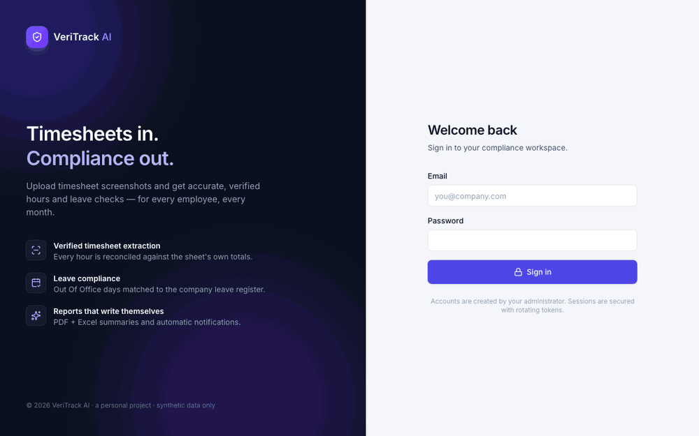

<sub>Upload → OCR with live progress → sheet review (reconstructed, verified grid) → leave analysis. All data shown is synthetic.
Full-quality video: <a href="docs/media/demo.mp4">docs/media/demo.mp4</a></sub>

</div>

---

## Contents

- [Why](#why) · [Features](#features) · [Screenshots](#screenshots)
- [How the OCR works](#how-the-ocr-works) · [Architecture](#architecture)
- [Quality and test results](#quality-and-test-results)
- [Getting started](#getting-started) · [Configuration](#configuration) · [Deployment](#deployment)
- [Roles](#roles-and-permissions) · [Security](#security) · [Project layout](#project-layout) · [Limitations](#known-limitations)
- Design doc: [docs/design.md](docs/design.md) · Threat model: [docs/threat-model.md](docs/threat-model.md)

## Why

When people record hours in one system and leave in another, someone has to check that the two agree:
that every *Out Of Office* day on a timesheet is also in the leave register. Done by hand from screenshots,
it is slow and error-prone, and one misread digit sends the wrong email.

VeriTrack automates that loop and is built around one rule: **a number that cannot be proven is never
acted on.**

VeriTrack is a personal project. Every sheet, person and organisation in it is synthetic; it is not
affiliated with, built for or used by any employer, and no real company, client or internal system is
involved.

## Features

| | |
|---|---|
| **Verified OCR** | A geometry-first reader for timesheet screenshots. Every hour is cross-checked against row totals, per-hour-type day totals and grand totals; cells the arithmetic pins down are auto-repaired, anything else is flagged *Needs review*. |
| **Leave compliance** | Timesheet *Out Of Office* days vs. the leave register (CSV/Excel import or manual entry). Missing days become violations with the exact dates, an email to the employee (Microsoft Graph), and PDF + Excel reports. |
| **Sheet review** | The reconstructed, colour-coded grid (optionally side by side with the uploaded screenshot) and the list of verification checks. |
| **Employee repository** | Versioned master data with inline correction and full history; OCR'd scans of employee lists are supported too. |
| **Built for teams** | Four roles with enforced scoping, audit log of every security-relevant action, analytics per manager. |
| **Holds up under load** | OCR runs off the request path with bounded concurrency; with 200 concurrent users on 2 vCPUs, once everyone has signed in, API requests take 26–29 ms at p50 while OCR keeps the CPU busy, and every file is processed exactly once. |
| **Polished UI** | Light/dark themes, command palette (`Ctrl/⌘ K`), collapsible sidebar, mobile layout, live progress, accessible components. |

## Screenshots

| | |
|---|---|
| 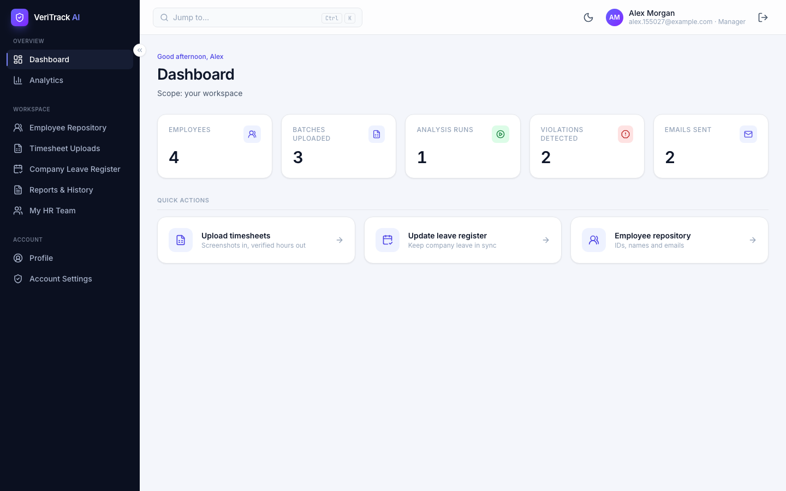 | 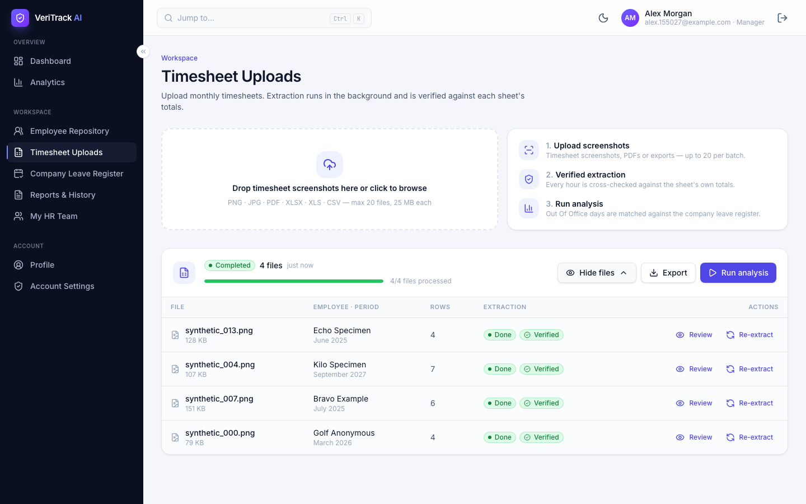 |
| **Dashboard** — role-scoped numbers and quick actions | **timesheet uploads** — per-file status, verification and actions |
| 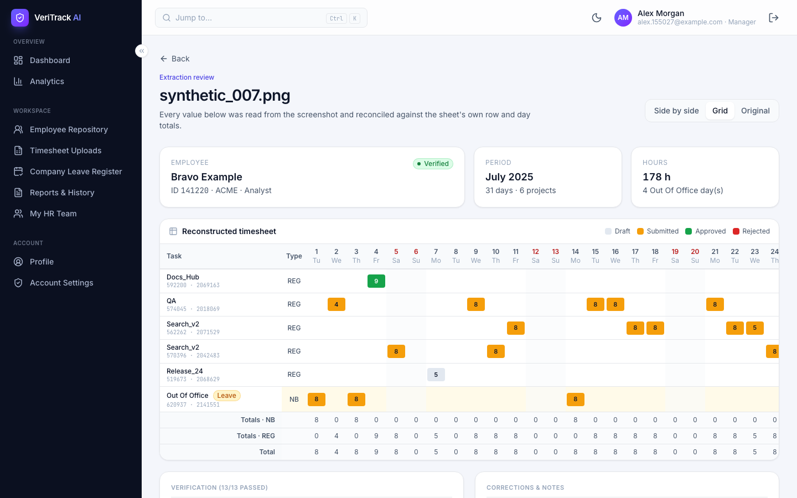 | 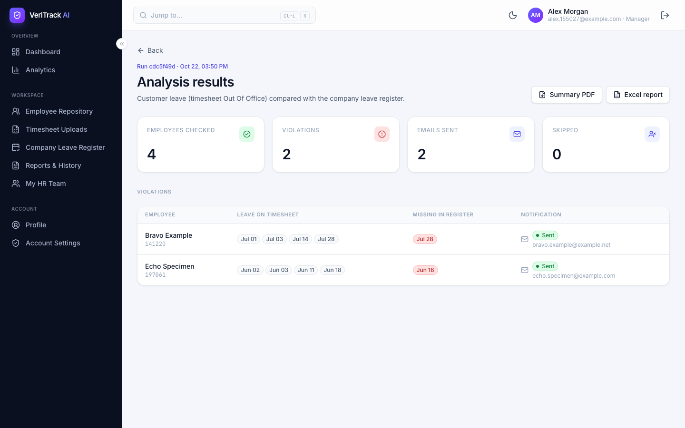 |
| **Sheet review** — reconstructed grid with verification checks | **Analysis** — missing leave days per employee, notification status |
| 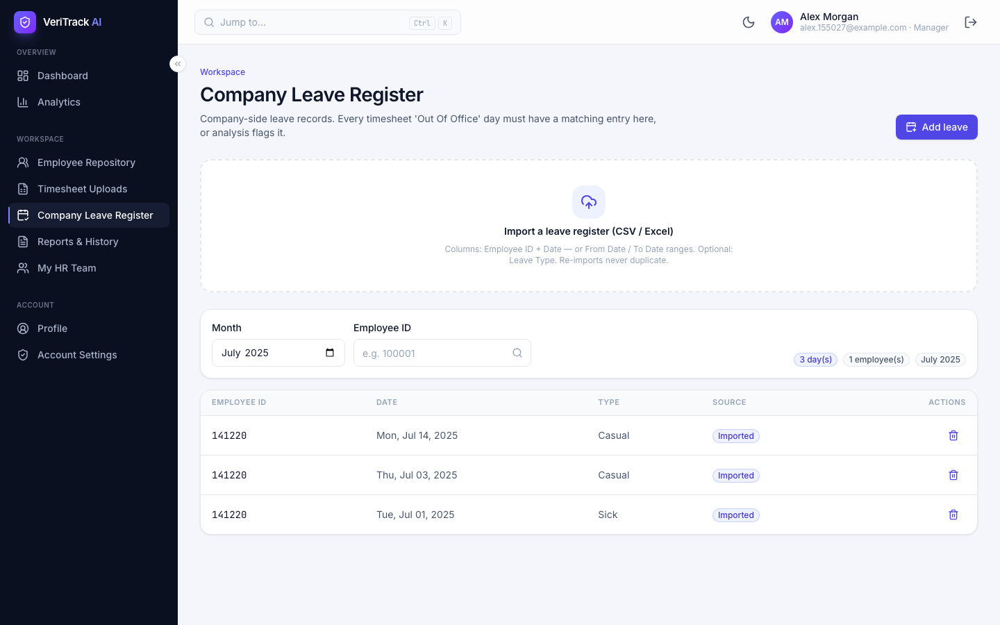 | 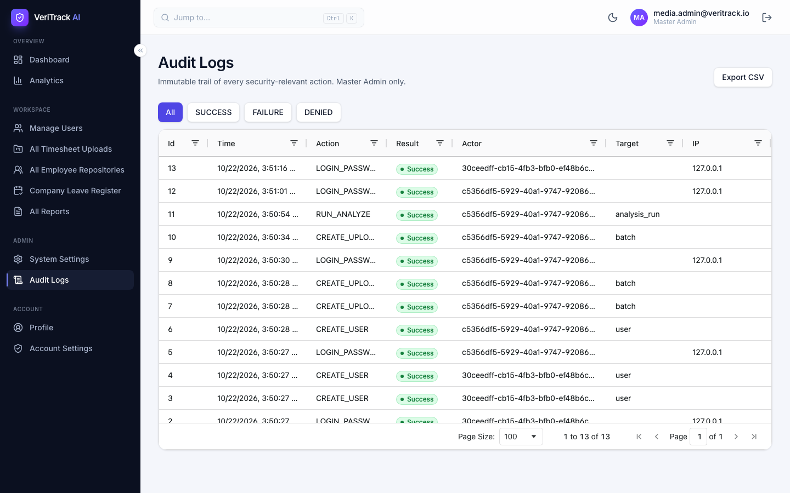 |
| **Company leave register** — import, filter, add, delete | **Audit logs** — filterable, exportable (Master Admin) |
| 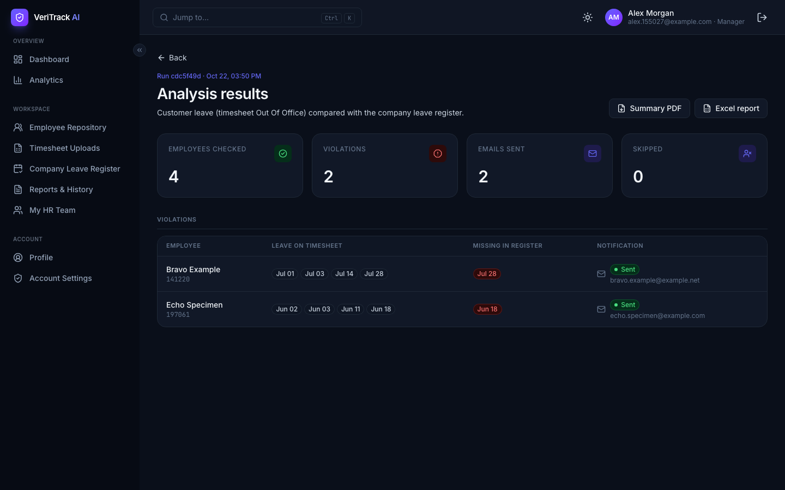 | 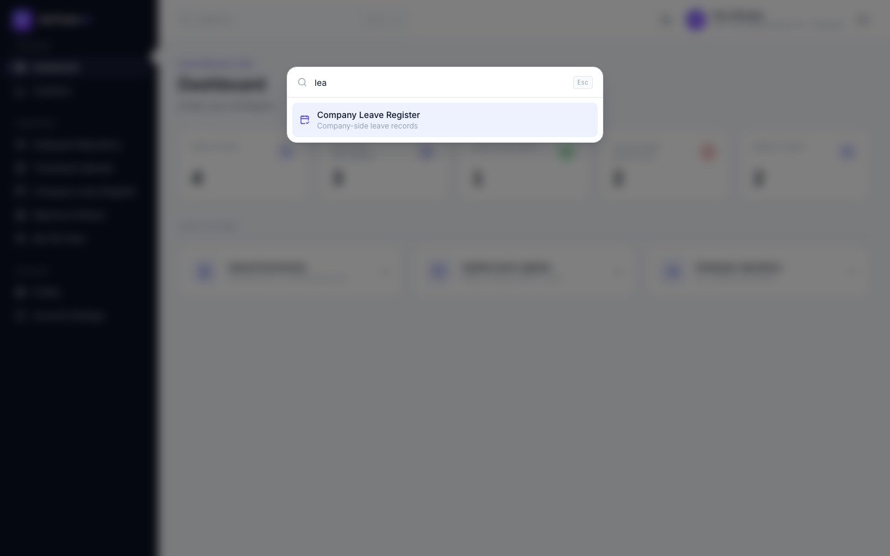 |
| **Dark theme** | **Command palette** |

<details>
<summary>More: login, employee repository, analytics, mobile</summary>

| | |
|---|---|
| 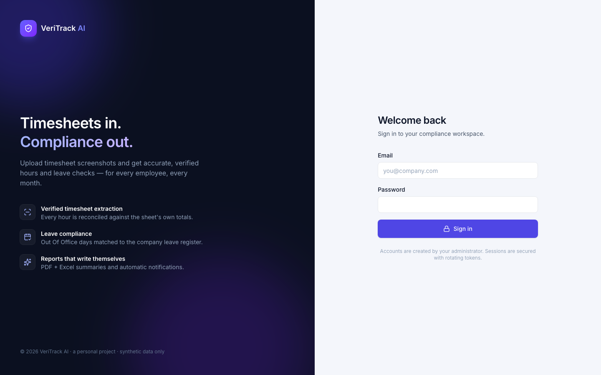 | 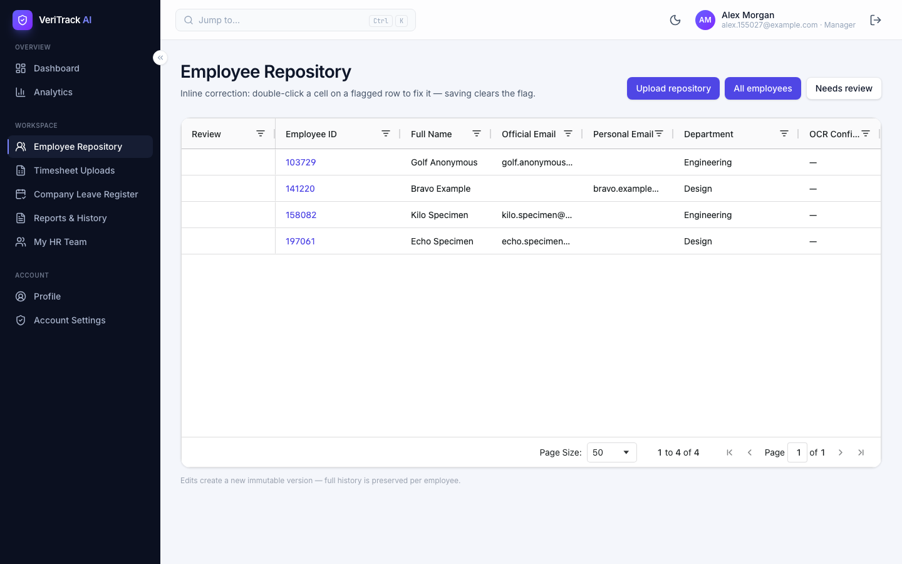 |
| 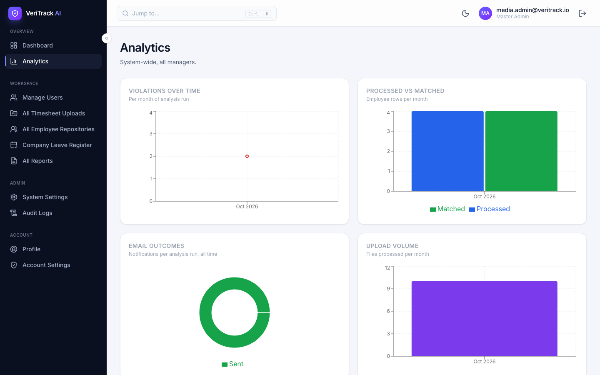 | 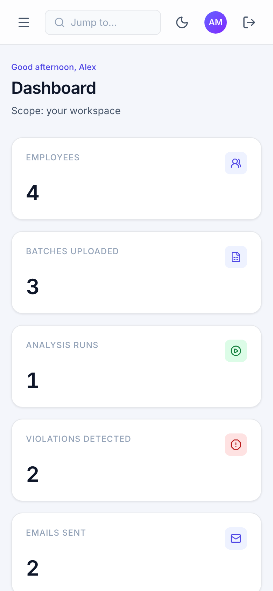 |

</details>

## How the OCR works

Generic OCR reads a timesheet as a cloud of words and loses which number belongs to which day. Timesheet pages
are rendered by a web app, so their *layout* is regular even when the data is not — the reader exploits that.

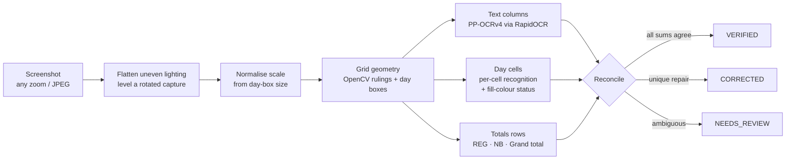

1. **Geometry first.** Uneven lighting is flattened and a slightly rotated capture is levelled; then day input
   boxes and table rulings are located with OpenCV, which yields the exact cell grid regardless of browser zoom
   (screens are normalised to a reference box size). Evenly lit, level screenshots pass through unchanged.
2. **Targeted recognition.** Text columns (Employee ID, Client, Role, Type, Project Code, Task, Task Code) and the
   page header (employee, period) are read with PP-OCRv4; each inked day cell is recognised on its own crop and
   its fill colour classified as *Draft / Submitted / Approved / Rejected*.
3. **Proof by arithmetic.** Every value is checked against the row total, the per-hour-type day totals and the
   grand total. A cell the equations determine uniquely is repaired and reported; an unreadable hour type is
   resolved the same way. Anything else is *Needs review* and is never emailed — including a sheet whose totals
   rows, grand total or month are missing, whose day columns do not match the month, whose employee ID is
   unreadable or differs between rows, whose task text could be leave or work, or that has handwriting over the
   table (a struck-through value the printed totals would still agree with).

**What "verified" means.** Every day's hours agree with the printed row and sheet totals, the employee ID and
period were read (and every row agrees on the ID), and every row's task was read clearly enough to tell leave
from work. Project and task codes, names, roles and task titles are **not** cross-checked. The review page and
the uploads table say the same.

## Architecture

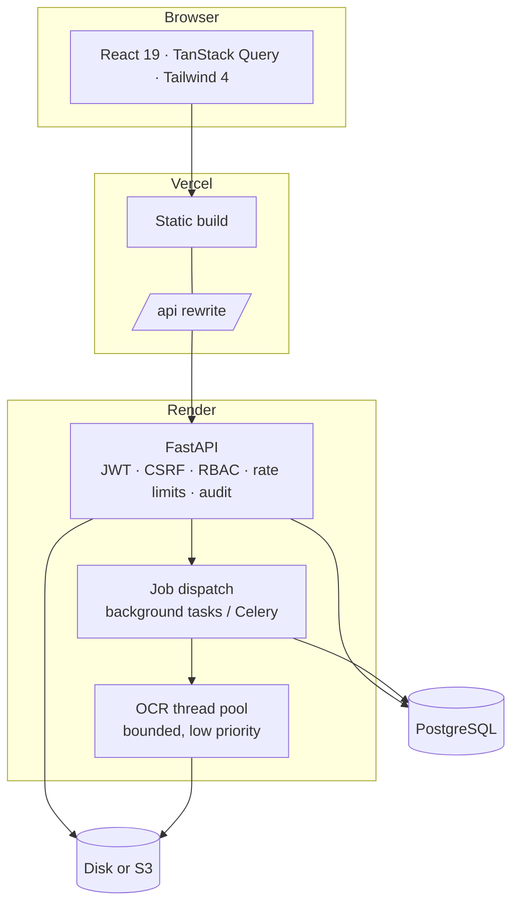

**Design decisions** (the full design, with the alternatives considered: [docs/design.md](docs/design.md))

- **Same-origin API.** Vercel proxies `/api/*` to Render, so the refresh cookie is first-party
  (`SameSite=Strict`) and no CORS preflights are needed.
- **Never block the event loop.** OCR, PDF/Excel generation, password hashing and storage I/O run in worker
  threads; OCR has its own pool sized by `OCR_CONCURRENCY` at lowered CPU priority, so requests stay fast
  while scans are processed. No database connection is held while a file waits for or runs OCR.
- **Exactly-once processing, even when a worker dies.** Claiming a batch or a file takes a lease (a token
  and an expiry the worker keeps renewing), and its results are written only while it still holds the lease.
  A reaper hands jobs whose lease ran out to another worker, and a worker that froze and wakes up late
  changes nothing. Tested by killing a real worker process mid-file (`tests/test_worker_crash.py`). Analyses
  have a unique run per batch and resume on startup.
- **Tenant isolation in the database.** Every row belongs to an organisation, and PostgreSQL row-level security
  shows each transaction only its own organisation's rows: a query that forgets to filter returns nothing extra.
  Each transaction runs as `veritrack_app`, a role that can never bypass the policies, whatever role the app
  logs in as. Background jobs look up their batch's organisation rather than inheriting one.
- **Tamper-evident audit log.** Each organisation's audit entries form a SHA-256 hash chain written by a database
  trigger, so no code path can skip it; the app may only append. `verify-audit-log` recomputes every chain
  and names the first entry that no longer fits. See the [threat model](docs/threat-model.md).
- **Stateless API.** Short-lived access tokens, rotating refresh tokens with reuse detection (and a 30 s grace
  window so parallel browser tabs don't log each other out). Scale out by adding instances.

## Quality and test results

Everything below runs in this repository against real PostgreSQL. No real employee data is committed; the
OCR suites use synthetic sheets with invented people and projects, rendered on demand by `scripts/gen_synthetic_timesheets.py` (they are never committed).

| Suite | What it proves | Result |
|---|---|---|
| **Backend** (`pytest tests`) | API, auth, rules, OCR, concurrency, recovery, exports, migrations | **379 passed** |
| &nbsp;&nbsp;OCR regression | 16 synthetic sheets (28–31-day months, 1–9 projects, 4 fonts, 90–150 % zoom) read field-for-field | **16/16 exact** |
| &nbsp;&nbsp;Capture conditions | 4 sheets × 7 degradations (80–200 % zoom, JPEG q60, blur, noise): every hour, total, status, ID and period | **28/28 exact** |
| &nbsp;&nbsp;Hostile inputs | cropped totals, cut-off columns, rotation, grayscale, tiny, padded: exact *or* flagged — never verified-and-wrong | **7/7** |
| &nbsp;&nbsp;Permission matrix | all 42 endpoints × 4 roles + anonymous; cross-manager access to every object type | **0 leaks** |
| &nbsp;&nbsp;Worker crashes (`pytest tests/test_worker_crash.py`) | a real worker process killed with SIGKILL mid-file, or frozen with SIGSTOP and resumed after its job was taken over | **every file's result written exactly once**; finished files not redone, the frozen worker's late results discarded |
| &nbsp;&nbsp;Audit log tampering (`pytest tests/test_audit_chain.py`) | edited, re-hashed, deleted, reordered and forged entries made directly in the database; truncated and fully rewritten chains against a recorded head; 40 concurrent writers; the migration's backfill | **every change caught** at the entry where it was made, except what the [threat model](docs/threat-model.md) lists |
| &nbsp;&nbsp;Organisation isolation (`pytest tests/test_tenant_isolation.py`) | another organisation's 4 roles against every route that takes an id, list, export and write; row-level security per table with raw SQL; passes logged in as a superuser too | **0 leaks** |
| **Frontend** (`npm test`) | pages, guards, flows, shell | **59 passed** |
| **End-to-end** (`pytest e2e`, real Chromium) | every page and button for all four roles, uploads, downloads, dark mode, palette, mobile, negative paths; fails on any console error or 5xx | **48 passed** against the production build (`npm run build && npx vite preview`), on a fresh database and on two further runs against the same one |
| **Load** (`gh workflow run load-test.yml`, 2 vCPU x86-64 runner) | 200 concurrent users, sign-ins all at once and spread over 60 s: 160 managers upload → OCR → analyse while 40 HR users browse | **both runs: 160/160 results correct, 0 errors, 0 cross-user leaks; 480/480 files processed exactly once** |

### OCR benchmark

220 held-out generated sheets, each with one degradation (blur, skew, noise, JPEG, shadow, low resolution,
stamp, pen marks, handwritten corrections, simulated photos), read on x86-64 — the architecture production
runs on. Development-set numbers (the 220 sheets the fixes were tuned on) are shown alongside. Method,
per-group results and failure analysis: [docs/ocr-benchmark.md](docs/ocr-benchmark.md).

| Metric (RapidOCR, production) | Held-out set | Development set | Before this round of fixes (development set) | Reproduce |
|---|---|---|---|---|
| Sheets read exactly | **96 / 220 (43.6 %)** | 86 / 220 (39.1 %) | 16 / 220 (7.3 %) | `gh workflow run ocr-benchmark.yml -f seed=4729` |
| **Verified but wrong** (a checked field wrong on a verified sheet) | **1 / 220** | 0 / 220 | 1 / 220 | same run |
| Verified, unchecked field wrong (code, name or title) | 9 / 220 | 8 / 220 | 1 / 220 | same run |
| Field accuracy · cell accuracy | 93.1 % · 98.4 % | 90.5 % · 98.0 % | 80.7 % · 96.0 % | same run |

Comparison engine on the same held-out sheets: Tesseract 5 read 27 / 220 exactly (12.3 %), 0 verified but
wrong, at a median 17.9 s per sheet against RapidOCR's 5.8 s (`-f engine=tesseract`).

### Load test

`gh workflow run load-test.yml -f ramp_seconds=0` and `-f ramp_seconds=60`
([`.github/workflows/load-test.yml`](.github/workflows/load-test.yml), [`scripts/load_test.py`](scripts/load_test.py)):
PostgreSQL, the API (one web worker, background processing, RapidOCR, `OCR_CONCURRENCY=2`) and the load
generator on one GitHub-hosted runner, 2 vCPU, 7 GB, x86-64, with `ENVIRONMENT=staging` because the runner's
database has no TLS. 200 users sign in, all at once or spread evenly over 60 s; each of 160 managers uploads an
employee repository, a leave register and a timesheet screenshot, polls for OCR the way the frontend does
(every 1.5 s, slowing to every 10 s as the upload ages), runs the analysis and checks it; 40 HR users browse
throughout, one page every 5 s. Latency is reported in two windows: the opening one, until the last user has
signed in, and steady state after it. bcrypt runs at cost 12 in both.

| Requests, except sign-in and uploads | Sign-ins all at once (run 39754076536) | Spread over 60 s (run 39754080742) |
|---|---|---|
| **Steady state**, p50 · p95 · p99 | **29 ms · 472 ms · 1.2 s** (31 689 requests) | **26 ms · 139 ms · 685 ms** (30 529) |
| Opening window, p50 · p95 · p99 | 1.9 s · 11.7 s · 20.9 s (935; last sign-in at 75 s) | 1.9 s · 8.0 s · 12.0 s (1 174; last sign-in at 85 s) |
| **Sign-in**, p50 · p95 · p99 | 32.6 s · 65.6 s · 70.8 s | 11.6 s · 24.2 s · 27.2 s |
| Upload (stored and queued), p50 · p95 · p99 | 2.0–2.3 s · 9.0–10.8 s · 12.6–16.9 s | 1.9–2.0 s · 6.1–7.0 s · 9.2–11.9 s |
| A manager's wait for OCR, median · last | 17.4 min · 30.9 min | 16.5 min · 29.5 min |
| Correct, isolated, errors | 160/160 · yes · 0 | 160/160 · yes · 0 (1 GET retried after a dropped connection, as the frontend retries once) |
| From `/metrics` | 480 files claimed once and finished once, no takeovers, nothing discarded | same |

Where it is slow, as measured:

- **Signing in.** bcrypt (cost 12) on 2 vCPUs: 200 sign-ins at once take 33 s at the median; spread over a
  minute, 12 s. The opening window's request latency comes from this burst and the uploads arriving with it.
- **OCR throughput.** 160 timesheets on two OCR threads: the median manager waits 16–17 min, the last ~30.
  Capacity grows with CPUs and `OCR_CONCURRENCY`, or with Celery workers. Run time varies between runners of
  the same size: one earlier all-at-once run finished in 8 min, with a median OCR wait of 4 min.
- **An earlier run starved.** With HR users opening four pages every half second and the frontend polling at
  a fixed 1.5 s, the API served ~90 requests a second and OCR, which runs at a lower priority, got almost no
  CPU: 58 of 160 sheets were unfinished after 48 minutes. Polling now backs off, and the HR users browse at
  a person's pace.

Load-test runs found these bugs, each fixed with a test that failed before or with the run that showed it:
database connections held through bcrypt and through storage, report and export work (pool timeouts, HTTP
500); bcrypt sharing the default thread pool with storage I/O; background jobs sharing the request pool, so a
burst of uploads starved requests (now a pool of their own); and a job's wait for a connection recorded as the
file's failure (jobs now wait up to `JOB_DB_POOL_TIMEOUT`).

## Getting started

**Prerequisites:** Python 3.12, Node 22, PostgreSQL 14+ (or Docker).

```bash
# backend
python -m venv .venv && .venv/bin/pip install -r requirements-dev.txt
cp .env.example .env                        # set ADMIN_PASSWORD
createdb veritrack                          # or: docker compose up -d db
.venv/bin/alembic upgrade head
.venv/bin/python -m app.cli create-master-admin   # admin of the first organisation
.venv/bin/python -m app.cli create-organization "Acme Ltd" --admin-email admin@acme.example   # another tenant
.venv/bin/python -m app.cli verify-audit-log  # exit 1 if any audit chain is broken
.venv/bin/uvicorn app.main:app --reload     # http://localhost:8000/docs

# frontend
cd frontend && npm ci && npm run dev        # http://localhost:5173
```

Or run the whole stack in containers: `docker compose up --build` → <http://localhost:8080>.

The database role that runs migrations needs `CREATEROLE` (migration 0008 creates `veritrack_app`). The
Compose database's role is a superuser; on a managed database the owner role usually has it.

## Configuration

All settings are environment variables (see [`.env.example`](.env.example)); production refuses insecure values.

| Variable | Purpose |
|---|---|
| `ENVIRONMENT` | `production` enables strict validation, secure cookies, HSTS and hides `/docs` |
| `DATABASE_URL` | PostgreSQL URL (`postgres://…` from hosting providers is accepted) |
| `JWT_SECRET_KEY` | ≥ 32 random characters |
| `CORS_ORIGINS` | explicit origins only (not needed with the Vercel rewrite) |
| `PROCESSING_MODE` | `background` (default) · `celery` (Redis + workers) · `inline` (tests) |
| `OCR_CONCURRENCY` | sheets read in parallel per API process (≈ CPU cores) |
| `JOB_LEASE_SECONDS` | how long a worker's claim on a job lasts without renewal (120); a dead worker's job is taken over after it |
| `JOB_MAX_ATTEMPTS` | a file interrupted this many times in a row is failed instead of retried (3) |
| `JOB_DB_POOL_SIZE` · `JOB_DB_POOL_TIMEOUT` | background jobs' own connection pool (5, plus 5 overflow) and how long a job waits for a connection (300 s) |
| `METRICS_TOKEN` | turns on `GET /metrics` (Prometheus) for bearers of this token; unset, the endpoint does not exist |
| `TRUSTED_PROXY_HOPS` | proxies in front of the API (`2` for Vercel → Render) — used for rate limits and the audit log |
| `STORAGE_BACKEND` | `local` · `volume` (persistent disk) · `s3` |
| `OUTBOUND_EMAIL_MODE` | `dry_run` (default, records only) · `live` with `GRAPH_*` credentials |
| `M365_*` | optional Microsoft Entra ID single sign-on |

## Deployment

Frontend on **Vercel**, API + PostgreSQL on **Render** — step by step in [docs/DEPLOYMENT.md](docs/DEPLOYMENT.md).

1. Render → **New → Blueprint** → this repository (`render.yaml` creates the API, the database and a disk).
   Set `ADMIN_EMAIL`, `ADMIN_PASSWORD`, `CORS_ORIGINS`.
2. Put the Render URL into [`vercel.json`](vercel.json) (`rewrites`).
3. Vercel → **Import** this repository (root directory = repository root).

## Testing

```bash
createdb veritrack_test
.venv/bin/playwright install chromium                       # renders the synthetic test timesheets
.venv/bin/python -m pytest -q tests                         # backend: ~12 min, includes OCR accuracy
cd frontend && npm test && npm run lint && npx tsc -b       # frontend
# end-to-end (needs the API on :8000 and `npm run dev` or `npm run preview`)
E2E_ADMIN_EMAIL=... E2E_ADMIN_PASSWORD=... .venv/bin/python -m pytest e2e -q
# load test against a running API
ADMIN_EMAIL=... ADMIN_PASSWORD=... .venv/bin/python -m scripts.load_test --managers 160 --hr 40 [--metrics-token T]
# OCR accuracy report, optionally on your own sheets
.venv/bin/python -m scripts.eval_ocr_accuracy --variants [--dir DIR]
```

CI (`.github/workflows/ci.yml`) runs lint, the backend suite against PostgreSQL, and the frontend type-check,
lint, tests and build on every push and pull request.

## Roles and permissions

| Role | Can |
|---|---|
| **Master Admin** | manage users, system settings and SSO domains, audit logs; see every manager's data in their organisation |
| **Executive** | analytics, every repository and report, manager & HR directory |
| **Manager** | upload timesheets, repositories and leave registers; run analyses; reports; create HR accounts |
| **HR** | read-only access to their manager's employees, timesheet exports and leave register |

The route guard and the API enforce the same table; `tests/test_permission_matrix.py` fails if an endpoint
is added without a permission decision.

**Organisations.** Each organisation has its own Master Admin, users and data, and no role sees another
organisation's. The first one is created on first start and administered by `ADMIN_EMAIL`; the platform
operator adds more with `python -m app.cli create-organization`. `tests/test_tenant_isolation.py` fails if an
endpoint is added without a cross-organisation check.

## Security

- Passwords hashed with bcrypt (cost 12, off the event loop); account lockout with no lockout oracle.
- Access JWT (15 min) + rotating refresh cookie (`HttpOnly`, `Secure`, `SameSite=Strict`) with reuse
  detection; CSRF double-submit token on cookie-authenticated endpoints.
- Rate limits per client address (resolved from a trusted proxy chain, so `X-Forwarded-For` cannot be forged)
  and per user for expensive endpoints.
- Uploads validated by magic bytes and size; CSV/Excel exports neutralise formula injection.
- Security headers (HSTS, `nosniff`, `DENY` framing, referrer policy); `/docs` disabled in production.
- Audit log for logins, user changes, uploads, analyses, exports and settings: append-only for the app and
  hash-chained, verified by `python -m app.cli verify-audit-log` or `GET /api/v1/audit-logs/verify`.
- CI scans every pull request, `main` and, weekly, the unchanged code
  ([`.github/workflows/security.yml`](.github/workflows/security.yml)): gitleaks over the tree and the pull
  request's commits, pip-audit, npm audit, and Trivy over the API image. CodeQL is set up but runs only once
  the repository is public: GitHub permits it on private code only with a paid add-on.
- `GET /metrics` exists only when `METRICS_TOKEN` is set and needs it as a bearer token: its queue counts span
  every organisation.
- Organisations isolated by PostgreSQL row-level security (forced, so it also binds the table owner) under a
  role that cannot bypass it; a row cannot be read, written or created outside the current organisation.

## Project layout

```
app/
  api/routers/        auth, users, uploads, employees, leaves, analysis, dashboard, analytics, audit, health
  services/           analysis rules, leave register, jobs, reporting, email, storage, …
    extraction/       readers, normalisation, pipeline, timesheet_grid (timesheet reader), generic_table (other scans)
  core/ db/ models/ schemas/
alembic/              migrations
frontend/             React app — pages, layouts, UI kit, tests
e2e/                  real-browser suite (Playwright)
scripts/              load test, OCR accuracy report, synthetic sheet generator, README media capture
test-data/           synthetic timesheets are generated here on demand (git-ignored)
tests/                backend suite
docs/                 design doc, threat model, deployment guide, OCR benchmark, screenshots, demo video
```

## Known limitations

- The timesheet reader is tuned to one timesheet layout (the one `scripts/gen_synthetic_timesheets.py` renders); other scans go through a generic table reader
  and are flagged for review more often.
- **Real phone photos have not been tested.** The reader is built for screenshots and digital exports;
  simulated photos (generated from screenshots) are all refused, and the app does not claim photo support.
- On the held-out benchmark **1 of 220 sheets was verified with a wrong value**: a handwritten correction that
  the handwriting check missed (the struck cell was repaired back to the printed value by the totals).
- Project and task codes, names, roles and task titles are not cross-checked; the employee ID must be readable
  and identical on every row, but is not checked against anything else.
- **OCR output differs between processor architectures.** The same code read 86 development sheets exactly on
  x86-64 and 94 on an ARM Mac; two errors appeared only on x86-64 ('M ig ration' for *Migration*, 'office' for
  a wrapped *Out Of Office*) and were fixed. Published numbers come from x86-64 CI runs.
- Pen marks that are not data (ticks, circles) also send a sheet to review.
- A batch's files are read one at a time (fair across managers); a sheet takes 5.8 s at the median on a
  GitHub-hosted x86-64 runner ([OCR benchmark](docs/ocr-benchmark.md)), so a large batch takes minutes.
- **Organisations are created by the operator** (CLI), not by self-service sign-up, and a user belongs to one
  organisation. E-mail addresses are unique across organisations, since they are the sign-in identity, so
  creating a user with an address another organisation uses is refused, which reveals that it exists. Likewise
  an SSO domain can be approved by only one organisation.
- The audit chain catches changes to past entries, but not a fake entry appended at the end, and a deleted
  tail or a fully recomputed chain only against a head recorded outside the database, which the app does
  not do automatically ([threat model](docs/threat-model.md)).
- A failed sign-in for an e-mail with no account belongs to no organisation, so no organisation's audit log
  shows it; it is kept in the database.
- Microsoft 365 sign-in and live e-mail need an Entra ID app registration and were exercised in dry-run mode.

## License

[MIT](LICENSE)
