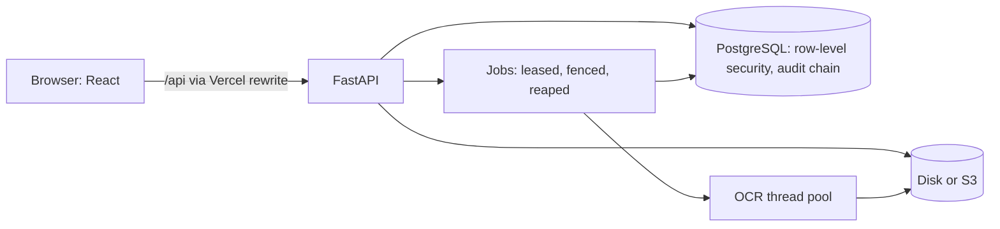

# VeriTrack: design

Author: Pavan Sai Kumar Dangeti · Status: implemented · Personal project

VeriTrack is a personal project. Every sheet, person and organisation in it is synthetic; it is not
affiliated with, built for or used by any employer, and no real company, client or internal system is
involved.

## Context and scope

When people record hours in one system and leave in another, someone has to check that the two agree: that
every *Out Of Office* day on a timesheet is also in the leave register. The timesheets often arrive only as
screenshots. VeriTrack reads those screenshots, checks the leave days against the register, and emails the
people whose leave is missing, with reports for their managers.

The hard part is not reading text; it is never acting on a misread number. A wrong digit becomes a wrong
email to a real person. So the design is organised around one rule: **a number that cannot be proven is
never acted on.**

In scope: one timesheet layout read from screenshots and digital exports, a leave register imported from CSV
or Excel, several organisations on one deployment, four roles. Out of scope: other timesheet layouts (they go
through a generic table reader and are flagged more often), photographs of paper, payroll.

## Goals and non-goals

Goals:
- A verified sheet is right. Measured as *verified but wrong*: verified sheets with a wrong checked field.
- Uploads, reads and analyses stay correct under concurrency and when a worker dies: every file's result is
  written exactly once.
- One organisation can never read or change another's data, even through a query that forgets to filter.
- The audit log cannot be quietly edited.
- Every published number comes from a script in the repository, with the command next to it.

Non-goals:
- Reading every sheet. A sheet the reader cannot prove goes to a person (*Needs review*); a high review rate
  is acceptable, a wrong verification is not.
- Real-time OCR. A timesheet takes seconds to minutes; users poll.
- Self-service sign-up. Organisations are created by the operator.

## Overview

One FastAPI service serves the API and, by default, runs the background jobs in the same process
(`PROCESSING_MODE=background`); Celery workers are the scale-out option. PostgreSQL holds everything except
the uploaded files, which go to local disk or S3.

## Detailed design

### Reading a timesheet

`app/services/extraction/timesheet_grid.py` locates the table's grid from its lines, not from the text: it
evens out lighting, levels a rotated capture, finds the row and column boundaries, and reads each cell on its
own with RapidOCR (PP-OCRv4 on onnxruntime). Then it proves the result:

- every day's hours must add up to the printed row totals, the per-hour-type day totals and the grand total;
- a cell the arithmetic pins down exactly is repaired, and the sheet is marked *corrected*;
- the employee ID and period must be readable, and every row that shows the ID must agree on it;
- each task must read clearly enough to tell leave from work;
- handwriting over the table blocks verification.

Anything that fails is *Needs review*. Project and task codes, names, roles and titles are not covered by any
total, so they are not cross-checked; what *verified* covers is stated in the UI and the README.

### Organisations

Every tenant row has an `org_id` (12 tables). PostgreSQL row-level security, forced so that it binds the
table owner too, shows each transaction only its organisation's rows, and refuses writes for another
(migrations 0007, 0008). A session hook copies the current task's organisation into each transaction as it
begins, and switches the transaction to `veritrack_app`, a role that can never bypass row-level security,
whatever role the app logs in as. A request runs in the signed-in user's organisation; a job looks up its
batch's organisation instead of inheriting one, so a Celery worker or the reaper runs in the right tenant.

### Jobs: exactly once, even when a worker dies

A batch is processed one file at a time. Claiming a batch or a file takes a lease: a fresh token and an
expiry (`JOB_LEASE_SECONDS`, 120 s), renewed every quarter lease while the worker runs
(`app/services/leases.py`). Every result write is a single conditional `UPDATE … WHERE lease_token = :token`,
so a worker that lost its lease writes nothing, with no gap between a check and the write. A reaper, at
startup and every half lease, re-dispatches batches whose lease ran out and batches whose dispatch was lost;
leases make the duplicates it may send harmless. A file interrupted `JOB_MAX_ATTEMPTS` (3) times in a row is
failed rather than retried forever.

Uploads write their files to storage before inserting any row, and no request or job holds a database
connection through slow work (bcrypt, storage, OCR, building reports): under load, held connections ran the
pool dry.

### Audit log

Each organisation's audit entries form a SHA-256 hash chain written by a database trigger, so no code path
can skip it (migration 0009). The application's role may only append. `python -m app.cli verify-audit-log`
and `GET /api/v1/audit-logs/verify` rebuild each entry's canonical text in Python from its raw fields, without
trusting any database function, and report the first entry that no longer fits. A chain recomputed in full,
or with its newest entries deleted, is caught only against a head recorded outside the database. Details:
[threat-model.md](threat-model.md).

### Sign-in and sessions

Passwords are bcrypt (cost 12), hashed on a pool of their own, one thread per CPU, so a burst of sign-ins
neither starves request handling nor queues storage I/O. Access tokens last 15 minutes; refresh tokens rotate,
and reusing one outside a 30-second grace window signs the user out everywhere. Microsoft 365 single sign-on
is optional and checks that the account belongs to the organisation that approved its domain.

## Alternatives considered

| Decision | Chosen | Instead of | Why |
|---|---|---|---|
| Reading the table | locate the grid from lines, then read each cell | OCR the whole image and group words into rows | the checks need to know which cell each number came from; the grid gives that directly, word grouping only approximates it |
| Trusting a read | prove it against the sheet's own totals | an OCR confidence threshold | a confidence score says how sure the engine is, not whether the value is right; the printed totals check the value itself |
| Tenant isolation | row-level security under a role that cannot bypass it | an `org_id` filter in every query | one forgotten filter leaks; the database refuses regardless, and the suite proves it per table |
| Exactly-once jobs | leases with fenced writes and a reaper | status-only claims plus recovery at startup | the old recovery judged by a batch's age and could reprocess one still running elsewhere (a test reproduces it) |
| Audit integrity | hash chain in the database, verified outside it | application-side hashing | a trigger cannot be skipped by a code path; the verifier does not trust the database's own functions |
| Background work | in the API process by default, Celery optional | a separate worker service always | one service fits a free hosting plan; the same job code runs on Celery when it needs to scale |

## Cross-cutting concerns

- **Security:** see [threat-model.md](threat-model.md). CI runs gitleaks over the tree and every pull
  request's commits, pip-audit, npm audit, and Trivy over the API image; CodeQL runs once the repository is
  public (GitHub permits it on private code only with a paid add-on).
- **Privacy:** no real personal data in the repository; test and benchmark sheets are generated on demand and
  never committed. Timesheet batches past the retention window are purged with their stored files.
- **Observability:** structured logs for every request and job step (batch, file, attempt, worker, duration);
  Prometheus metrics at `GET /metrics` behind `METRICS_TOKEN` (files by outcome, claims and takeovers,
  processing time, queue depth, oldest waiting file, lapsed leases).
- **Testing:** backend tests against real PostgreSQL, including a permission matrix over every endpoint and
  role, a cross-organisation suite over every route, audit tampering made directly in the database, and a real
  worker process killed mid-file; frontend unit tests; a real-browser end-to-end suite.

## Measurements

Each is produced by a script in this repository; the numbers and the command are in the README.

| What | Result | Command |
|---|---|---|
| OCR, 220 held-out sheets, x86-64 | 96 exact (43.6 %), **1 verified but wrong** | `gh workflow run ocr-benchmark.yml -f seed=4729` |
| Organisation isolation | 0 leaks over every route, and per table with raw SQL | `pytest tests/test_tenant_isolation.py` |
| Audit tampering | every listed change caught where it was made | `pytest tests/test_audit_chain.py` |
| Worker killed or frozen mid-job | every file's result written exactly once | `pytest tests/test_worker_crash.py` |
| 200 concurrent users, 2 vCPU | see README → Load test | `gh workflow run load-test.yml` |

## Known gaps

- Real phone photos are untested, and simulated photos are all refused.
- OCR output differs between processor architectures; published numbers come from x86-64.
- The audit chain cannot tell a fake entry appended at the end from a real one, and heads are not recorded
  outside the database automatically.
- OCR throughput on 2 vCPUs is the bottleneck under load: capacity grows with CPUs, `OCR_CONCURRENCY` or
  Celery workers.
- E-mail addresses and SSO domains are unique across organisations, so trying one reveals that it exists.
